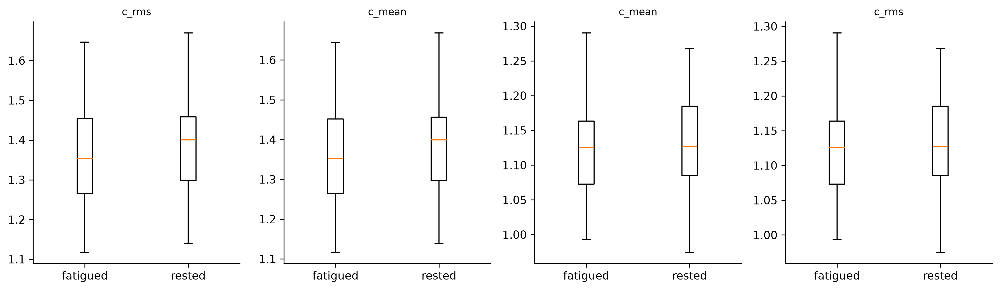
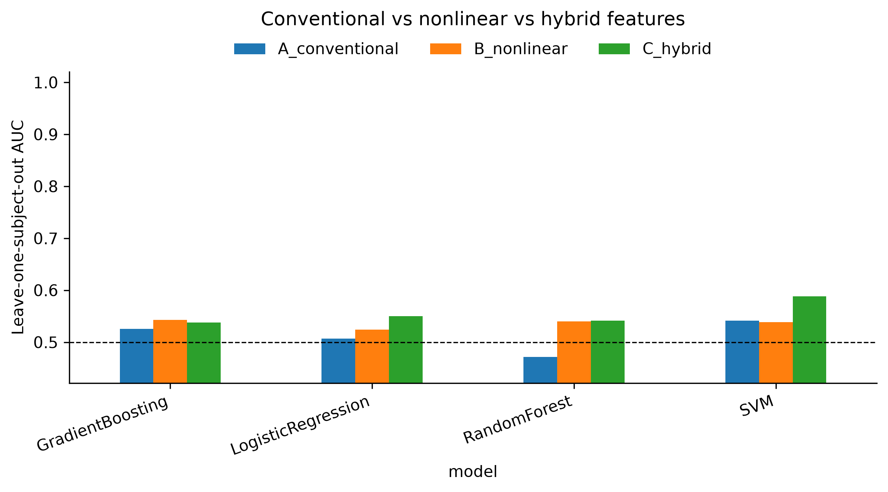
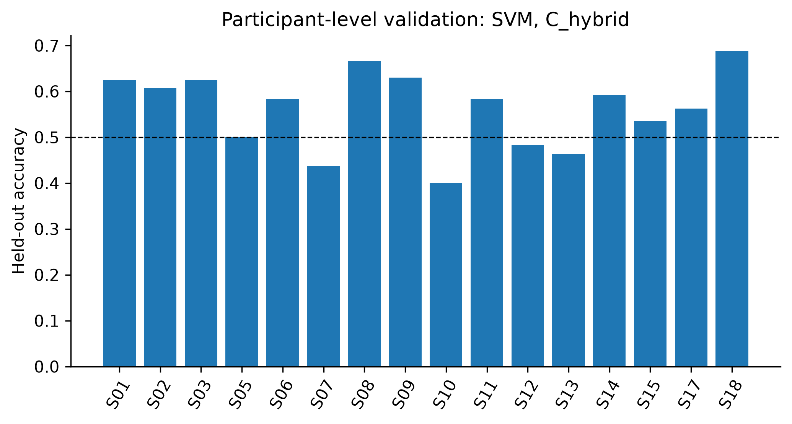
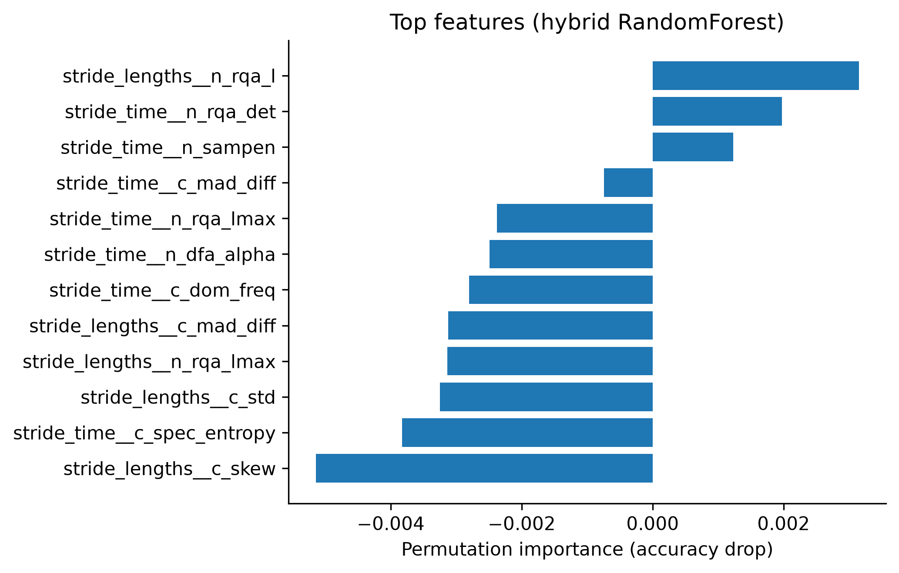

# NonlinearGait
**Nonlinear Time-Series Analysis and Machine Learning for Fatigue-Related Changes in Human Gait**


[](https://github.com/Somiyakhan10/NonlinearGait/actions/workflows/tests.yml)


**NonlinearGait** asks a simple question: *do nonlinear measures of walking add anything beyond ordinary summary statistics when you try to tell movement conditions apart?*

It takes stride-by-stride gait recordings from two public datasets, computes conventional and nonlinear features in sliding windows, and compares machine-learning models built on each feature set. Every model is tested on people it has never seen (**leave-one-subject-out**), so windows from one person never end up in both training and test data.

The project downloads the data itself, processes it in a temporary folder, keeps only the derived features and results, and deletes the raw files afterwards. It runs efficiently on a laptop with very little free disk space.

---

## 📸 Results & Screenshots

*The figures below come from the real **DUO-GAIT** dataset (fatigued vs. rested walking, 16 healthy adults). The main finding is a negative one: no feature set separated the two conditions reliably.*

### 1. Feature Distributions

*Feature values for fatigued and rested windows overlap almost completely.*

### 2. Model Comparison (AUC)

*Leave-one-subject-out AUC for each model on conventional, nonlinear and hybrid features. Every result stays close to the 0.5 chance line (dashed), so no feature set separates fatigued from rested walking reliably.*

### 3. Participant-Level Accuracy

*Held-out accuracy for each participant (SVM, hybrid features). Results scatter around the 0.5 chance line, from 0.40 to 0.69.*

### 4. Feature Importance

*Permutation importance for the hybrid Random Forest. Values are tiny (about 0.003 change in accuracy) and mostly negative, so no feature is a reliable driver of the predictions.*

---

## ✨ Core Features

*   **Automatic Data Handling:** Downloads datasets, checks file integrity, extracts only the necessary files, and cleans up raw data. Interrupted downloads resume automatically.
*   **Conventional Features:** Mean, standard deviation, coefficient of variation, RMS, range, skewness, kurtosis, median absolute difference, dominant frequency, and spectral entropy.
*   **Nonlinear Features:** Sample Entropy (SampEn), Recurrence Quantification Analysis (RQA: RR, DET, L, Lmax, LAM, TT), largest Lyapunov exponent (Rosenstein method), and Detrended Fluctuation Analysis (DFA).
*   **Machine Learning Models:** Logistic Regression, SVM, Random Forest, Gradient Boosting (and XGBoost if installed). Each is trained on three feature sets: Conventional, Nonlinear, and Hybrid.
*   **Honest Validation:** Leave-one-subject-out (LOSO) testing, per-participant accuracy, bootstrap confidence intervals, and a paired bootstrap comparison of nonlinear vs. conventional features.
*   **Explainability:** Permutation importance and SHAP (if installed) to show which features drive the models' decisions.
*   **Synthetic Demonstration Mode:** A built-in simulated dataset to test the software without downloading real data. Results are clearly labelled and saved separately.
*   **Encryption:** AES-256-GCM for datasets you are not allowed to leave unprotected. Keys are kept outside the project folder.
*   **Outputs:** A Markdown report, CSV tables for each feature family, and 300-dpi figures for every run.

---

## 📊 Summary of Scientific Results

### Dataset 1: DUO-GAIT (Fatigue vs. Rested)
*   **Participants:** 16 healthy adults (stride time and stride length from foot sensors).
*   **Results:** Models performed close to chance (AUC roughly 0.47 to 0.59, per-participant accuracy 0.40 to 0.69). Permutation importances were near zero.
*   **Conclusion:** With these features and this sample size, no reliable fatigue signal was found. This is a valid negative result, not a failed run.

### Dataset 2: PhysioNet Long-Term Recordings
*   **Participants:** 10 healthy adults (spontaneous vs. metronome-paced walking). This dataset has no fatigue labels.
*   **Results:** High classification performance (AUC up to about 0.97). Paced walking showed weaker long-range correlation (DFA α ≈ 0.6) than spontaneous walking (DFA α ≈ 0.85).
*   **Conclusion:** Paced and spontaneous walking are easy to tell apart, but nonlinear features did not improve on conventional ones. The hybrid set performed within noise of the conventional set.

---

## 🛠️ Installation & Setup

```bash
# 1. Clone the repository
git clone https://github.com/Somiyakhan10/NonlinearGait.git
cd NonlinearGait

# 2. Create a virtual environment
python -m venv .venv

# 3. Activate the environment
.venv\Scripts\activate          # Windows
source .venv/bin/activate       # macOS/Linux

# 4. Install dependencies
pip install -r requirements.txt

# 5. (Optional) Install SHAP and XGBoost
pip install shap xgboost
```

On Windows you can also double-click `SETUP.bat`, then `RUN_PROJECT.bat`.

---

## ▶️ Usage

```bash
python main.py                          # real data: download, analyse, report, clean up
python main.py --datasets umwdb         # one dataset (umwdb, duo_gait, duo_gait_raw, local_folder)
python main.py --synthetic              # simulated demo, for testing the software only
python main.py --experiment nonlinear   # one feature set: conventional, nonlinear, hybrid
python main.py --inspect duo_gait       # list a dataset's files and columns
python main.py --run-tests
```

Results are written to `output/real/<dataset>/`. Start with `report.md`. Settings live in `config/config.yaml` and `config/datasets.yaml`. Encryption commands (`--generate-key`, `--encrypt-folder`, `--decrypt-file`) and the Google Colab notebook are described in `INSTALLATION_GUIDE.md` and `CLOUD_PROCESSING_GUIDE.md`.

### Running it without installing anything

- **GitHub Actions:** open the repository's *Actions* tab, choose *run-analysis*, click *Run workflow* and download the `results` artifact when it finishes. The tests run automatically on every push.
- **Google Colab:** the notebook in `notebooks/colab_run.ipynb` clones this repository and runs the same code.

Simulated data is always labelled and stored separately in `output/synthetic/`. If a real dataset cannot be downloaded, the program says so and stops for that dataset. It never substitutes synthetic data.

---

## 📚 Data

Hausdorff JM et al. Fractal dynamics of human gait: stability of long-range correlations in stride interval fluctuations. *J Appl Physiol* 80:1448-1457 (1996). Long-term Recordings of Gait Dynamics, PhysioNet. Check the dataset page for its licence.

Zhou L, Fischer E, Brahms CM, Granacher U, Arnrich B. DUO-GAIT: a gait dataset for walking under dual-task and fatigue conditions with inertial measurement units. *Scientific Data* 10, 543 (2023). doi:10.1038/s41597-023-02391-w. Data: doi:10.5281/zenodo.8244887. See the licence file in the Zenodo record.

Details, file layouts and storage sizes are in [DATASET_GUIDE.md](DATASET_GUIDE.md).

---

## ⚠️ Limitations

Both datasets are small (10 and 16 participants), so confidence intervals are wide. The PhysioNet data have no fatigue labels, and DUO-GAIT fatigue was induced by a lab protocol in healthy adults, which may not carry over to load carriage or clinical settings. Nonlinear estimates from short windows are noisy and depend on parameter choices. The DUO-GAIT "rested" folders were identified from folder names. The Re²Load data are not public, so they are not included, but the `local_folder` option accepts authorised data, optionally encrypted.
